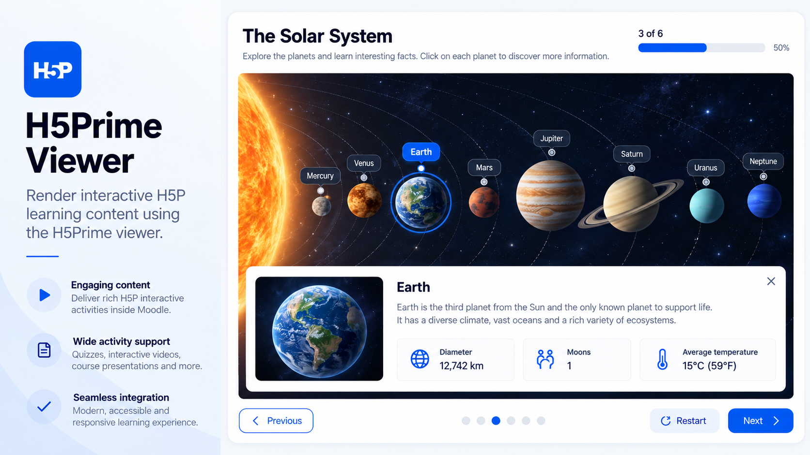
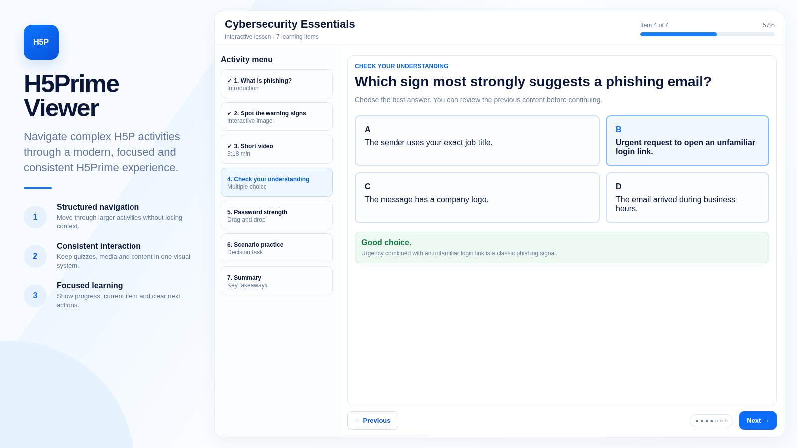
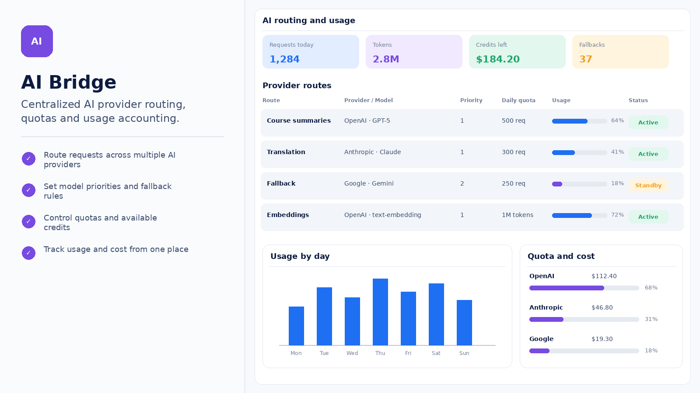
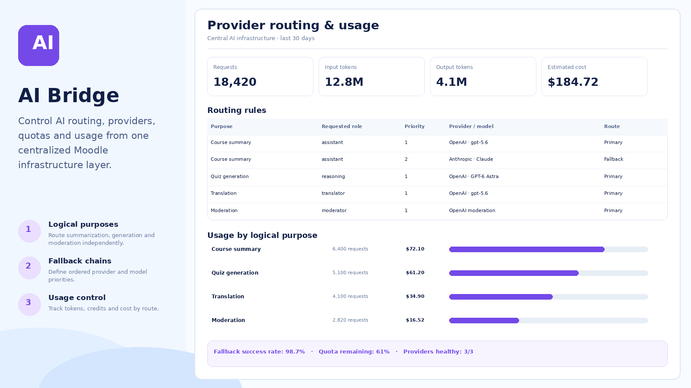
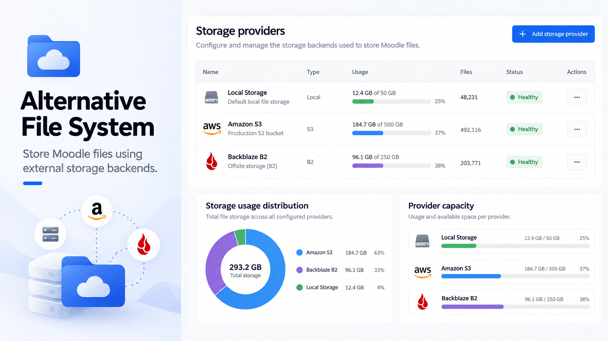
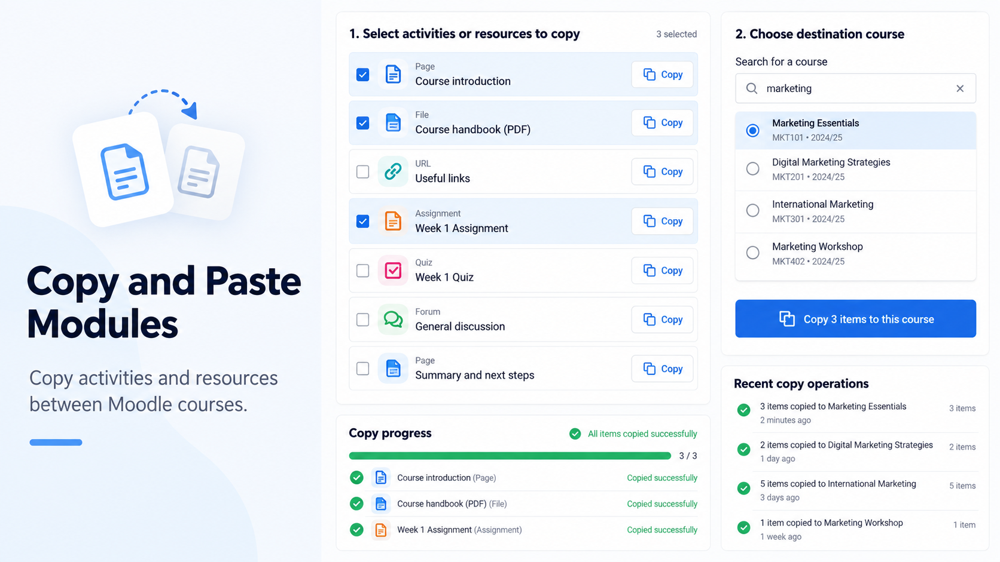

# Guia de criação das screenshots do Marketplace

Este arquivo define o padrão visual, técnico e de conteúdo das screenshots usadas pelo `marketplace-plugins`.

A screenshot não deve ser tratada apenas como uma captura de tela. Ela é uma peça de apresentação do plugin e precisa explicar rapidamente o que ele faz, mostrar uma interface coerente com o Moodle e continuar visualmente consistente quando exibida ao lado das screenshots dos demais plugins do catálogo.

A regra principal é simples: a imagem precisa mostrar a funcionalidade real do plugin de forma clara. Não adianta criar uma interface bonita que sugira recursos que o plugin não possui.

## Onde salvar

Cada plugin possui uma pasta própria usando exatamente o componente Moodle:

```text
screenshots/[component]/
```

O padrão recomendado usa duas imagens, mas uma única screenshot é válida quando já apresenta adequadamente o plugin:

```text
screenshots/[component]/new-1.png
screenshots/[component]/new-2.png
```

Exemplos:

```text
screenshots/mod_videoforum/new-1.png
screenshots/mod_videoforum/new-2.png

screenshots/tiny_screenrecorder/new-1.png
screenshots/tiny_screenrecorder/new-2.png

screenshots/local_mcp/new-1.png
screenshots/local_mcp/new-2.png
```

O nome da pasta deve ser exatamente o componente Moodle, normalmente o mesmo valor de `$plugin->component`.

Não use o nome completo do repositório:

```text
moodle-mod_videoforum     -> errado
mod_videoforum            -> correto
```

Se realmente forem necessárias imagens adicionais, mantenha a sequência:

```text
new-3.png
new-4.png
new-5.png
```

Mas não crie imagens extras apenas para mostrar a mesma tela com pequenas diferenças.

## Quantidade recomendada

A recomendação do catálogo é:

```text
1 screenshot principal obrigatória
2 screenshots quando houver um segundo fluxo relevante
```

Na maioria dos casos, duas imagens são suficientes. Não crie uma segunda imagem artificial apenas para cumprir uma quantidade.

A primeira imagem apresenta o conceito principal do plugin e a segunda mostra uma visão complementar.

Uma boa dupla responde a duas perguntas diferentes:

```text
new-1.png -> O que esse plugin faz?
new-2.png -> Como ele funciona em outra etapa importante do fluxo?
```

Se as duas imagens parecem praticamente iguais, uma delas está desperdiçada.

## Papel da new-1.png

A `new-1.png` é a principal imagem do plugin.

Ela deve apresentar a proposta de valor mais importante e uma tela que faça sentido imediatamente para quem ainda não conhece o plugin.

Normalmente funciona melhor mostrar:

- a experiência principal do aluno;
- a tela central da atividade;
- o dashboard principal;
- a funcionalidade que diferencia o plugin;
- a configuração mais importante, quando o plugin é essencialmente administrativo.

Exemplos:

```text
Video Reactions
-> vídeo sendo assistido com reações na timeline

Video Rubric
-> submissão em vídeo com avaliação por rubrica

Screen Recorder
-> gravação de tela integrada ao TinyMCE

Mastery Practice
-> visão geral de progresso por domínio
```

A `new-1.png` não deve tentar mostrar tudo. Ela precisa deixar a função principal óbvia em poucos segundos.

## Papel da new-2.png

A `new-2.png` deve complementar a primeira.

Ela precisa mostrar outra parte relevante do produto, por exemplo:

- visão do professor depois de mostrar a visão do aluno;
- analytics depois de mostrar a atividade;
- configuração depois de mostrar o uso;
- revisão de tentativa depois de mostrar a execução;
- gestão em massa depois de mostrar um usuário individual;
- autoria do conteúdo depois de mostrar o consumo;
- evidências detalhadas depois de mostrar o resumo.

Exemplos:

```text
new-1: aluno reage ao vídeo
new-2: professor analisa reações e participação

new-1: aluno executa checkpoints
new-2: professor configura os checkpoints

new-1: visão geral de tracking
new-2: análise detalhada de uma sessão

new-1: pacote de vídeos para o aluno
new-2: professor organiza o pacote e define regras
```

Evite simplesmente trocar dados, nome do usuário ou título da atividade mantendo exatamente a mesma tela.

## Formato técnico

O formato final é PNG.

Não usar:

- JPG;
- JPEG;
- WebP;
- GIF;
- SVG como screenshot final.

As imagens atuais seguem formato widescreen próximo de 16:9.

As seis imagens de referência usam a proporção widescreen 16:9; uma resolução prática é:

```text
1600 x 900 px
```

Também são adequadas resoluções 16:9 maiores, por exemplo:

```text
1920 x 1080 px
```

O ponto importante é manter a mesma proporção visual entre os plugins.

Não misture screenshots quadradas, verticais e widescreen dentro da mesma família.

## Referências visuais obrigatórias

Ao criar ou refazer screenshots, use **estas seis imagens do próprio catálogo como referência visual prioritária**, em vez de interpretar as instruções apenas de forma abstrata. Observe a distribuição entre apresentação e produto, a ausência do layout externo do Moodle, a hierarquia de textos, o nível de detalhe da interface e a continuidade entre telas do mesmo plugin.

As referências estão dentro do repositório e devem ser abertas antes da geração; não são apenas exemplos de nomes de arquivos.

<details>
<summary><code>screenshots/h5plib_vh5prime/new-1.png</code></summary>



</details>

<details>
<summary><code>screenshots/h5plib_vh5prime/new-2.png</code></summary>



</details>

<details>
<summary><code>screenshots/local_ai_bridge/new-1.png</code></summary>



</details>

<details>
<summary><code>screenshots/local_ai_bridge/new-2.png</code></summary>



</details>

<details>
<summary><code>screenshots/local_alternative_file_system/new-1.png</code></summary>



</details>

<details>
<summary><code>screenshots/local_copy/new-1.png</code></summary>



</details>

**O que reproduzir:** coluna de apresentação do produto à esquerda, área principal útil à direita, interface clara e realista, conteúdos concretos e elementos com bom tamanho para leitura. As proporções e cores são referências, não um molde rígido: o acento pode seguir a identidade do plugin, inclusive roxo, desde que a coleção continue visualmente coerente.

**O que não reproduzir:** cabeçalho do site Moodle, barras de menus do Moodle, navegação global, índice do curso, gavetas de navegação, coluna de blocos à esquerda ou à direita e painéis vazios que simulem essas áreas. O foco é a interface do plugin, não a página completa do Moodle.

## Estrutura visual

O padrão atual usa duas áreas bem definidas.

### Coluna de apresentação

A região esquerda ocupa aproximadamente 25% a 35% da largura, conforme a referência escolhida.

Ela funciona como uma pequena apresentação do plugin e normalmente contém:

1. ícone do plugin;
2. nome do plugin;
3. frase curta explicando a função;
4. pequeno traço azul de separação;
5. três benefícios ou recursos principais.

Estrutura visual aproximada:

```text
[ ÍCONE ]

Nome do
Plugin

Frase curta explicando
o principal benefício.

────

[ícone] Recurso principal
        Explicação curta.

[ícone] Segundo recurso
        Explicação curta.

[ícone] Terceiro recurso
        Explicação curta.
```

Não transforme essa coluna em uma página de vendas cheia de texto.

O nome do plugin precisa ser o elemento mais forte.

### Área de interface

A região direita ocupa o espaço restante, aproximadamente 65% a 75% da imagem.

É nela que a funcionalidade deve ser demonstrada.

A interface deve parecer uma aplicação real:

- cabeçalho;
- abas ou navegação **interna à própria funcionalidade** quando forem indispensáveis, mas nunca menus do Moodle;
- cards;
- tabelas;
- formulários;
- gráficos;
- vídeo;
- timeline;
- filtros;
- estados;
- botões;
- dados de exemplo.

Não preencha a área apenas com cards genéricos. A tela precisa contar uma história sobre o funcionamento do plugin. Mostre diretamente o conteúdo do plugin, sem a moldura completa de uma página Moodle.

## Não gerar menus nem áreas laterais de blocos do Moodle

**Regra obrigatória para todas as screenshots: não gerar menus do Moodle nem áreas de blocos laterais, à esquerda ou à direita.**

Isso inclui:

- barra superior do Moodle, cabeçalho global, links de administração e navegação do site;
- menu lateral de navegação, gaveta de navegação, menu de administração ou índice do curso;
- coluna de blocos do Moodle à esquerda;
- coluna de blocos do Moodle à direita;
- blocos Moodle simulados, ainda que vazios ou apenas decorativos;
- grandes margens reservadas para um menu, gaveta ou área lateral de blocos.

A **coluna de apresentação do plugin à esquerda não é uma área de blocos do Moodle**: ela continua fazendo parte do modelo visual e deve trazer o ícone, o nome, a descrição e os recursos do produto.

Da mesma forma, **um menu que pertence à própria funcionalidade do plugin não é um menu do Moodle**. Por exemplo, o *Activity menu* visto na referência do H5Prime faz parte da experiência da atividade e pode aparecer quando esse tipo de navegação for real e necessário. Abas, filtros ou seletores internos ao produto também são permitidos; o que está proibido é inserir o entorno de navegação e blocos do Moodle para preencher espaço.

A área à direita da apresentação deve mostrar o plugin diretamente, ocupando toda a região útil. Se a interface original estiver dentro de uma página Moodle com menus ou blocos, remova visualmente essas regiões na composição promocional sem inventar funcionalidades.

## Identidade visual

As screenshots devem parecer parte da mesma família.

O padrão observado nas referências utiliza:

- fundo branco ou azul muito claro;
- grandes áreas brancas;
- azul frequente nas interfaces, mas acentos coerentes com o plugin, inclusive roxo como no AI Bridge;
- azul royal ou a cor do plugin para ações;
- azul claro para elementos secundários;
- texto principal azul-marinho ou quase preto;
- cinza azulado para descrições;
- cards brancos;
- bordas muito discretas;
- cantos arredondados;
- sombras suaves;
- bastante espaço em branco.

Cores adicionais podem aparecer conforme o significado:

- verde para sucesso, aprovado e concluído;
- amarelo ou laranja para atenção, pendência e prazo;
- vermelho para erro, atraso, reprovação ou risco;
- roxo para IA, automação ou indicadores secundários;
- ciano para tecnologia, conexão ou progresso.

Evite trocar toda a identidade para outra cor apenas por decoração; porém, não force o azul em um produto cuja identidade já usa outra cor. O elo principal da coleção é a composição clara, legível e consistente, como mostram as seis imagens de referência.

## Relação com o ícone

A screenshot deve usar um ícone coerente com o ícone oficial do plugin.

O conceito visual precisa ser o mesmo.

Por exemplo, se o `icon.png` usa:

```text
vídeo + relógio
```

a screenshot não deve apresentar na coluna esquerda um símbolo completamente diferente, como:

```text
documento + estrela
```

A screenshot pode usar uma versão visual simplificada do ícone para funcionar melhor dentro do layout, mas deve continuar imediatamente reconhecível como o mesmo produto.

O guia de criação dos ícones está em:

```text
ICON_GUIDE.md
```

## Tipografia

Use uma sans-serif moderna e limpa.

O título do plugin deve ser grande, escuro e com bastante peso.

A hierarquia típica é:

```text
Nome do plugin
-> muito grande e bold

Tagline
-> grande, mas mais clara

Título de recurso
-> bold

Descrição
-> menor e em cinza azulado

Interface
-> hierarquia natural de aplicação web
```

Evite:

- fontes decorativas;
- serifas;
- texto excessivamente fino;
- texto minúsculo;
- dezenas de pesos diferentes;
- títulos inteiros em caixa alta.

## Idioma

Por padrão, use inglês nas screenshots do marketplace.

Isso mantém as imagens consistentes com o restante da apresentação internacional dos plugins.

Exemplos:

```text
Learner progress
Activity settings
Completion
Review attempt
Save changes
View analytics
```

Não misture português e inglês dentro da mesma screenshot.

Se houver uma razão específica para criar uma versão localizada, trate isso como um conjunto separado.

## Texto da coluna esquerda

A tagline precisa explicar a função do plugin em uma frase simples.

Prefira:

```text
Track multiple videos as one learning package.
```

em vez de:

```text
An innovative and powerful solution designed to transform the learning experience.
```

Evite linguagem promocional vazia.

Os três recursos abaixo da tagline também devem ser concretos.

Bom:

```text
Automated reminders
Send scheduled reminders and escalation emails automatically.
```

Ruim:

```text
Powerful experience
Take your learning to the next level.
```

A screenshot deve explicar produto, não escrever propaganda genérica.

## Conteúdo da interface

Antes de criar a imagem, leia:

- README;
- descrição no `plugins.json`;
- telas reais do plugin, quando existirem;
- código relevante;
- capabilities;
- configurações;
- relatórios;
- fluxos principais.

Não deduza tudo pelo nome do repositório.

Tente responder:

> Qual tarefa concreta o usuário consegue executar com este plugin?

Depois monte a tela em torno dessa tarefa.

Por exemplo:

```text
Video Tracker Premium
-> acompanhar prazo, progresso, lembretes e escalonamento

Authorship
-> revisar como uma resposta textual foi construída ao longo da tentativa

Moodle MCP
-> administrar clientes, scopes, ferramentas e eventos de autenticação
```

## Não inventar funcionalidades

Uma screenshot promocional pode simplificar ou reorganizar visualmente a interface, mas não deve inventar recursos.

Não mostre, por exemplo:

- gravação se o plugin não grava;
- IA se o plugin não usa IA;
- nota automática se ela não existe;
- reconhecimento facial se não existe;
- analytics que o plugin não calcula;
- integração que não está implementada;
- botão de uma ação impossível.

Dados fictícios são permitidos para demonstrar o fluxo.

Funcionalidades fictícias não.

## Dados de exemplo

Use dados fictícios e visualmente claros.

Podem ser usados nomes como:

```text
Emma Wilson
Daniel Lee
Sophia Patel
John Smith
Michael Chen
```

Use cursos e atividades genéricos:

```text
Sustainable Business
Biology 101
Data Privacy Training
Fractions and Decimals
Customer Service Training
```

Nunca coloque:

- dados reais de clientes;
- e-mails reais;
- IPs reais de usuários;
- nomes de instituições sem autorização;
- informações pessoais reais;
- tokens;
- chaves;
- secrets.

Quando um IP for necessário visualmente, use faixas reservadas para documentação, por exemplo:

```text
203.0.113.24
198.51.100.7
```

## Pessoas e avatares

É aceitável usar avatares ou pessoas fictícias dentro da interface quando isso ajuda a explicar o fluxo.

Exemplos:

- vídeo gravado por aluno;
- resposta em vídeo;
- perfil em analytics;
- avatar em conversa;
- revisão de tentativa.

A pessoa não deve dominar a screenshot inteira sem motivo.

A interface continua sendo o produto principal.

Mantenha diversidade visual entre os usuários fictícios e evite repetir exatamente a mesma pessoa em todos os plugins.

## Densidade de informação

A imagem pode ter bastante conteúdo, mas precisa continuar compreensível.

Uma boa screenshot consegue ser lida em três níveis:

### Primeiro nível

Em poucos segundos:

- nome do plugin;
- propósito;
- tela principal.

### Segundo nível

O usuário percebe:

- recursos principais;
- cards;
- gráficos;
- status;
- fluxo.

### Terceiro nível

Ao ampliar a imagem:

- textos;
- métricas;
- datas;
- filtros;
- detalhes.

Não coloque vinte elementos com o mesmo peso visual.

Sempre deve existir uma hierarquia clara.

## Cards e componentes

O padrão atual usa cards com:

- fundo branco;
- border-radius moderado;
- borda muito clara;
- sombra mínima;
- espaçamento interno generoso.

Evite cards excessivamente flutuantes com sombras pesadas.

A interface deve parecer um sistema profissional, não uma coleção de cartões soltos.

## Botões

A ação principal normalmente usa azul forte.

Exemplos:

```text
Save changes
Publish grade
Add video
Create client
Send reminder
```

Ações secundárias podem usar:

- botão branco com borda azul clara;
- link azul;
- botão cinza muito claro.

Use vermelho apenas para ações destrutivas ou estados críticos.

## Status

Use cores de maneira consistente.

### Verde

```text
Completed
Active
Passed
Approved
Valid
Mastered
```

### Azul

```text
In progress
Informational state
Selected item
```

### Amarelo ou laranja

```text
Due soon
Pending
Practising
Needs attention
```

### Vermelho

```text
Overdue
Failed
Revoked
Denied
Critical
```

### Cinza

```text
Not started
Disabled
No data
```

Não use cores aleatórias só para deixar a tela mais colorida.

## Gráficos

Gráficos devem existir apenas quando ajudam a explicar a função.

Prefira:

- barras;
- linhas;
- donuts;
- timelines;
- heatmaps;
- progresso;
- comparações simples.

Evite gráficos decorativos sem relação com os dados do plugin.

Um gráfico precisa responder alguma pergunta real, por exemplo:

```text
Onde os alunos abandonam o vídeo?
Qual grupo possui maior conclusão?
Quais skills estão dominadas?
Quantos clientes MCP estão ativos?
```

## Tabelas

Tabelas funcionam muito bem para plugins administrativos, relatórios e analytics.

Use:

- cabeçalho claro;
- poucas colunas relevantes;
- status em pills;
- barras de progresso quando ajudam;
- ações discretas;
- dados fictícios consistentes.

Evite tabelas com quinze colunas minúsculas.

É melhor mostrar oito colunas legíveis do que reproduzir toda a tabela real e torná-la ilegível.

## Screenshots de vídeo

Quando o plugin trabalha com vídeo, a interface pode mostrar um player.

O player deve parecer funcional:

- botão play;
- timeline;
- duração;
- volume;
- CC quando fizer sentido;
- fullscreen;
- marcadores quando fazem parte da função.

Se a funcionalidade envolve eventos na timeline, mostre esses eventos visualmente.

Exemplos:

- comentários;
- reações;
- checkpoints;
- seeks;
- pausas;
- heatmap;
- segmentos obrigatórios.

Não use um player genérico que não demonstra o diferencial do plugin.

## Continuidade entre new-1 e new-2

As duas imagens precisam parecer do mesmo produto.

Mantenha:

- o mesmo nome;
- o mesmo ícone;
- a mesma família de azul;
- a mesma tipografia;
- a mesma largura da coluna esquerda;
- os mesmos cantos e cards;
- o mesmo estilo de botões;
- o mesmo nível de detalhe.

Mas altere a função demonstrada.

Exemplo correto:

```text
new-1 -> learner-facing
new-2 -> teacher-facing
```

Exemplo ruim:

```text
new-1 -> dashboard com 68%
new-2 -> mesmo dashboard com 72%
```

## Criação com IA

Ao gerar screenshots com IA, use screenshots existentes como referência visual.

O ideal é fornecer:

- as seis imagens listadas em **Referências visuais obrigatórias**, quando disponíveis;
- a `new-1.png` do próprio plugin ao gerar a `new-2.png`;
- o ícone correspondente quando necessário.

Isso ajuda a preservar:

- proporção;
- coluna esquerda;
- tipografia;
- cores;
- espaçamento;
- cards;
- densidade;
- estilo geral.

Não peça simplesmente:

```text
Create a screenshot for a Moodle plugin.
```

Isso normalmente gera um dashboard genérico que não combina com o restante da coleção.

## Prompt base para new-1.png

Use algo próximo deste modelo:

```text
Create a polished 16:9 marketplace screenshot for a Moodle plugin called "[PLUGIN NAME]".

Use the six mandatory reference images in SCREENSHOT_GUIDE.md to match the visual family: a left product presentation panel and a large detailed product interface on the right. Do not draw Moodle navigation, Moodle header, site menus, course index, left or right Moodle block regions, or empty spaces reserved for them.

Maintain a clean light blue and white design, rounded cards, subtle shadows, modern sans-serif typography, accents consistent with the plugin identity (including purple when appropriate) and clear information hierarchy.

Left promotional panel:
- plugin icon
- title: "[PLUGIN NAME]"
- short subtitle explaining the plugin's main purpose
- thin blue divider
- three concrete feature bullets with simple circular icons

Right product interface:
Show the plugin's primary workflow:
[DESCRIBE THE REAL MAIN WORKFLOW]

Use realistic fictional data and concise English interface text.

Do not invent capabilities that are not part of the plugin.

The UI should look like a polished Moodle plugin product screen, not a generic landing page or a full Moodle site page with navigation and block sidebars.

16:9 composition.
```

## Prompt base para new-2.png

A segunda imagem deve receber a primeira como referência.

Use algo próximo deste modelo:

```text
Image A is the existing new-1.png for this plugin.

Create a distinct second marketplace screenshot, new-2.png, for the same Moodle plugin.

Preserve the same product identity:
- same plugin name
- same icon concept
- same left promotional panel
- same blue and white visual family
- same typography
- same rounded-card UI language
- same overall 16:9 composition
- no Moodle site menus, header, course index, navigation drawers or left/right Moodle block areas

Do not duplicate Image A.

The new screenshot must show a complementary workflow:
[DESCRIBE THE SECOND IMPORTANT WORKFLOW]

Keep the left panel visually consistent, but update the three feature bullets when useful to reflect the workflow shown on this screen.

Use realistic fictional data.

Do not invent functionality.

The result must look like a natural second screenshot of the same product.
```

## Como escolher as duas telas

Antes de gerar, escreva duas frases:

```text
new-1 mostra:
...

new-2 mostra:
...
```

Se as frases forem praticamente iguais, escolha outra segunda tela.

Alguns pares que funcionam bem:

```text
atividade / relatório
aluno / professor
execução / configuração
dashboard / detalhe
visão geral / auditoria
criação / consumo
tentativa / revisão
lista / detalhe
configuração / resultado
individual / turma
```

## Pós-processamento

Depois da geração:

1. confirme que a imagem está em proporção 16:9;
2. confirme que está em PNG;
3. verifique se o título do plugin está correto;
4. confirme que a imagem corresponde ao componente certo;
5. verifique se não existe texto cortado;
6. confira se botões e cards não ultrapassam o canvas;
7. verifique se nenhum elemento importante está encostado na borda;
8. confirme que a interface não mostra funcionalidades inexistentes;
9. confirme que `new-1.png` e `new-2.png` são diferentes entre si;
10. salve em `screenshots/[component]/new-N.png`.

## Validação rápida

Antes de fazer commit, confira:

- [ ] pasta chamada exatamente com o componente Moodle;
- [ ] arquivos chamados `new-1.png` e `new-2.png`;
- [ ] PNG;
- [ ] proporção widescreen 16:9;
- [ ] mesma identidade visual das demais screenshots;
- [ ] coluna promocional à esquerda (não é uma área de blocos Moodle);
- [ ] interface principal à direita;
- [ ] sem menus do Moodle, cabeçalho global, índice do curso ou gavetas de navegação;
- [ ] sem áreas de blocos Moodle à esquerda ou à direita;
- [ ] comparação visual com as seis referências deste guia;
- [ ] nome correto do plugin;
- [ ] tagline curta e concreta;
- [ ] três recursos reais do plugin;
- [ ] texto principal legível;
- [ ] sem elementos cortados;
- [ ] sem dados pessoais reais;
- [ ] sem secrets ou tokens reais;
- [ ] sem funcionalidades inventadas;
- [ ] `new-1.png` apresenta a função principal;
- [ ] `new-2.png` apresenta um fluxo complementar;
- [ ] as duas imagens parecem claramente do mesmo produto;
- [ ] interface coerente com Moodle;
- [ ] inglês consistente dentro da imagem;
- [ ] dados fictícios visualmente plausíveis.

## O que evitar

Evite principalmente:

- duas screenshots praticamente iguais;
- screenshot sem explicar a função do plugin;
- dashboard genérico sem relação com a funcionalidade;
- excesso de texto na coluna esquerda;
- frases promocionais vazias;
- muitos cards com o mesmo peso;
- cores incoerentes com a identidade visual do plugin e as referências;
- sombras exageradas;
- fonte decorativa;
- interface minúscula;
- menus e áreas laterais de blocos do Moodle;
- texto cortado;
- logos aleatórios;
- funcionalidades que não existem;
- nomes ou dados reais de clientes;
- tokens ou chaves reais;
- misturar português e inglês;
- imagem quadrada ou vertical;
- JPG quando o catálogo espera PNG;
- usar o nome do repositório no lugar do componente Moodle.

## Regra principal

A screenshot precisa explicar o plugin antes de impressionar visualmente.

Quando houver dúvida entre mostrar mais elementos ou deixar o fluxo mais claro, prefira clareza.

`new-1.png` deve fazer alguém entender o produto.

`new-2.png` deve mostrar que existe profundidade além da primeira tela.

As duas juntas precisam apresentar o plugin como um produto coerente, real e tecnicamente plausível.
